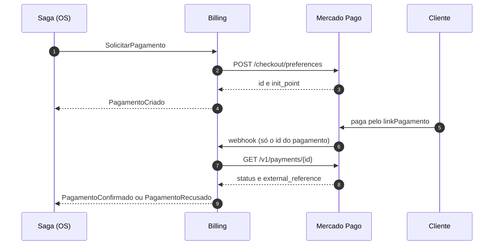

# garageos-billing-service

[](https://github.com/TechChallengeFase1/garageos-billing-service/actions/workflows/ci.yml) [](https://sonarcloud.io/summary/overall?id=TechChallengeFase1_garageos-billing-service) [](https://sonarcloud.io/component_measures?id=TechChallengeFase1_garageos-billing-service&metric=coverage) [](https://sonarcloud.io/summary/overall?id=TechChallengeFase1_garageos-billing-service) [](https://sonarcloud.io/summary/overall?id=TechChallengeFase1_garageos-billing-service)

Microsserviço **Billing** do GarageOS — Tech Challenge Fase 4.

Dono dos orçamentos das ordens de serviço e das cobranças. É o serviço com o banco **não relacional** da solução.

| | |
|---|---|
| Banco | Amazon DynamoDB, tabela única on-demand (ADR 0007) |
| Mensageria | Amazon SQS/SNS com MassTransit 8.5 |
| Pagamento | Mercado Pago, Checkout Pro |
| Papel na saga | Participante: gera, cancela e cobra o orçamento |
| Namespace no EKS | `garageos-billing` |

A saga é **orquestrada** pelo OS Service: este serviço só reage aos comandos e responde com eventos. Por que orquestrada, e não coreografada: [README do OS Service](https://github.com/TechChallengeFase1/garageos-os-service#saga-pattern-por-que-orquestração).

As decisões de arquitetura estão nos ADRs 0004 a 0007 em
[`garageos-os-service/docs/adrs`](https://github.com/TechChallengeFase1/garageos-os-service/tree/main/docs/adrs).

## Rotas

| Método | Rota | Quem | Descrição |
|---|---|---|---|
| `POST` | `/api/orcamentos` | Admin | Gera o orçamento a partir dos itens com preço. Idempotente por OS |
| `GET` | `/api/orcamentos?ordemDeServicoId=` | Admin | Orçamento de uma OS |
| `GET` | `/api/orcamentos/{id}` | Admin ou o cliente dono | Orçamento com itens |
| `POST` | `/api/orcamentos/{id}/enviar` | Admin | Pendente → Enviado |
| `PATCH` | `/api/orcamentos/{id}/resposta` | Admin ou o cliente dono | Aprovação ou recusa |
| `POST` | `/api/orcamentos/{id}/cancelar` | Admin | Cancelamento (compensação). Idempotente |
| `POST` | `/api/orcamentos/{id}/pagamentos` | Admin | Abre a cobrança de um orçamento aprovado. Idempotente |
| `GET` | `/api/orcamentos/{id}/pagamentos[/{pagamentoId}]` | Admin | Cobranças do orçamento |
| `POST` | `/api/orcamentos/{id}/pagamentos/{pagamentoId}/verificar` | Admin | Consulta o resultado no Mercado Pago, sem depender do webhook |
| `POST` | `/api/orcamentos/{id}/pagamentos/{pagamentoId}/simular` | Admin | Informa o resultado à mão. Só com `Pagamentos:Provedor=Fake`; senão 404 |
| `POST` | `/api/webhooks/mercadopago` | pública, com assinatura | Notificações de pagamento do Mercado Pago |
| `GET` | `/health/live` · `/health/ready` | pública | Health checks (o ready faz `DescribeTable`) |

"Cliente dono" é o token do login por CPF cujo `sub` é o `clienteId` do orçamento.

### Modelo da tabela

| PK | SK | Item |
|---|---|---|
| `ORC#{id}` | `META` | Orçamento, com os itens embutidos |
| `ORC#{id}` | `PAG#{id}` | Pagamento do orçamento |
| `OS#{osId}` | `ORCAMENTO` | Marcador: garante um orçamento por OS |

Orçamento e marcador são gravados na mesma transação com `attribute_not_exists`, o que torna a geração idempotente mesmo com requisições simultâneas. Alterações usam concorrência otimista pelo atributo `version`.

## Pagamento: Mercado Pago

O cliente paga no **Checkout Pro**, na página do Mercado Pago, então nenhum dado de cartão passa por este serviço. O serviço conhece só a interface `IGatewayDePagamento`; `Pagamentos:Provedor` escolhe entre `MercadoPago` e `Fake`.



| Status no Mercado Pago | Efeito |
|---|---|
| `approved` | `Confirmado`, avisa a saga |
| `rejected`, `cancelled` | `Recusado`, avisa a saga (que compensa) |
| `refunded`, `charged_back` | `Estornado` |
| demais (`pending`, `in_process`) | espera a próxima notificação |
| `approved` numa cobrança já recusada ou expirada | devolve o valor: a OS já foi compensada |

**Decisões:**

- **O corpo da notificação não é confiável.** O webhook valida a assinatura `x-signature` (HMAC-SHA256) e depois consulta o pagamento na API. Assim, um aviso forjado ou repetido não muda nada: o que vale é a resposta do Mercado Pago.
- **Idempotente pela regra de negócio, não por tabela de deduplicação.** Reaplicar o mesmo resultado não grava nada. Consulta e transição são seguras de repetir, e concorrência cai no controle de versão do item, com o Mercado Pago reentregando.
- **`external_reference` = `{orcamentoId}:{pagamentoId}`**, a chave do item no DynamoDB, para achar o pagamento sem índice.
- **`binary_mode`**: aprova ou recusa na hora, sem "em análise" segurando a saga.
- **Validade de 10 minutos**, igual ao prazo de pagamento da saga. No cancelamento, a preferência é expirada.
- **Provedor fora do ar**: 503 no webhook (ele reentrega); retry do MassTransit nos consumidores. Persistindo, o prazo da saga compensa.

A API de preferências ignora `X-Idempotency-Key` (verificado no sandbox), então a chave só é enviada no estorno.

### Credenciais

Ficam no segredo `garageos-producao-billing/mercadopago`, nunca no repositório:

```bash
aws secretsmanager put-secret-value --secret-id garageos-producao-billing/mercadopago \
  --secret-string '{"accessToken":"...","publicKey":"...","webhookSecret":"..."}'
```

`webhookSecret` é a assinatura secreta do painel (Suas integrações → Webhooks). `MercadoPago:NotificationUrl` é `{url do API Gateway}/billing/api/webhooks/mercadopago?source_news=webhooks`.

### Testar no sandbox

Abra o `linkPagamento` numa janela anônima, logado com a conta **compradora** de teste (a vendedora não pode pagar a si mesma). Use o cartão de teste do painel (Suas integrações → sua aplicação → Cartões de teste), CPF `12345678909`, com o nome `APRO` para aprovar ou `OTHE` para recusar.

## Como rodar localmente

```bash
cp .env.example .env   # preencha o JWT
docker compose up -d --build
```

Sobe a API e o DynamoDB Local; a tabela é criada na subida. Swagger em <http://localhost:8081/swagger>.

## Testes

```bash
dotnet test Code/GarageOS.Billing.UnitTests           # sem dependências
dotnet test Code/GarageOS.Billing.IntegrationTests    # precisa de Docker (DynamoDB Local via Testcontainers)
```

### Cobertura

**99,0% de linhas**, somando os testes unitários, de integração. A CI publica o relatório HTML no artifact `cobertura`, mostra o resumo na execução e falha abaixo de 80%.

Ficam de fora só as migrations, geradas pelo EF, e o `Program.cs`, que só liga as peças e é exercitado pelos testes de integração. As regras estão em [`coverlet.runsettings`](Code/coverlet.runsettings).

## Observabilidade

No New Relic com nome próprio (`garageos-billing`). O `X-Correlation-Id` de quem iniciou a operação chega
em cada mensagem e volta aos logs (`CorrelationId`, `OrdemDeServicoId`, `MessageType`) e aos eventos de
negócio. Detalhes e o dashboard da saga: [observabilidade](https://github.com/TechChallengeFase1/garageos-os-service/tree/main/docs/observabilidade).

## Infraestrutura (`infra/`)

Terraform com o que é só deste serviço: repositório ECR, banco, role IRSA dos pods e
parâmetros SSM em `/garageos/producao/services/billing/*`. O state fica em
`services/billing/terraform.tfstate`, no bucket compartilhado.

Pré-requisitos, nesta ordem:

1. Este repositório listado em `github_repos` no bootstrap (`garageos-infra-database/bootstrap`), com o apply feito.
2. Cluster no ar pelo `garageos-infra-k8s`, que publica o OIDC do cluster e o namespace deste serviço.
3. Depois do primeiro apply, gravar as credenciais de teste do Mercado Pago no segredo `garageos-producao-billing/mercadopago`.

O workflow [`infra.yml`](.github/workflows/infra.yml) faz plan no PR e apply no merge na `main`.
Depois de recriar o cluster, reaplique: a trust da role IRSA aponta para o OIDC do cluster, que muda.

## Deploy (`k8s/`)

A CI chama o workflow [`cd.yml`](.github/workflows/cd.yml) depois que build, testes e Sonar passam na `main`: gera a imagem no ECR, cria o Secret a partir do Secrets Manager, aplica os manifestos e confere a saúde pelo API Gateway. Com a infra destruída, ele avisa e pula o deploy. Os valores de cada ambiente vêm do SSM. Antes dele precisam estar aplicados o `infra/` deste repositório e o `garageos-lambda-auth`, que publica a URL do API Gateway, e o segredo do Mercado Pago precisa estar gravado.

O serviço responde em `{url do API Gateway}/billing/...`: o Traefik escolhe o serviço pelo prefixo e o tira antes de chegar à API.

Para acessar o Swagger:

```bash
aws eks update-kubeconfig --name garageos-producao --region us-east-1
kubectl port-forward -n garageos-billing svc/garageos-billing 8081:80
```

Depois abra <http://localhost:8081/swagger>.
